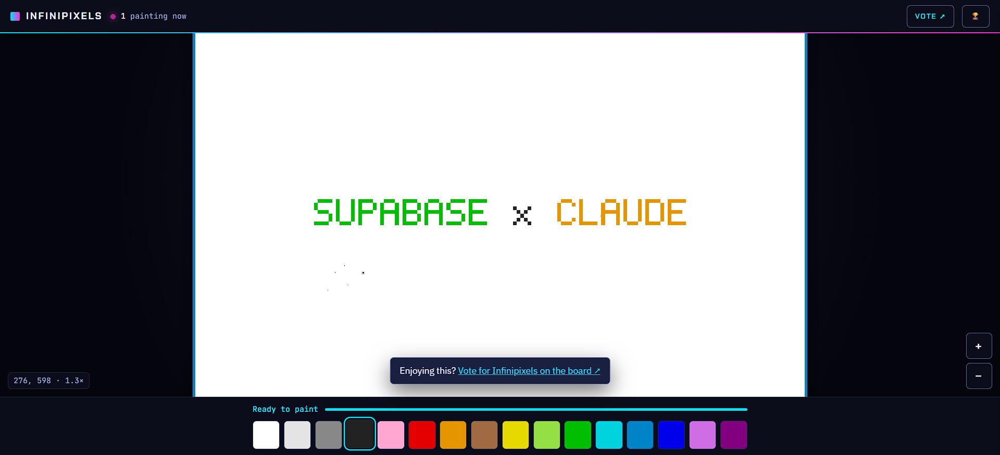

<div align="center">

# Infinipixels

**1,000,000 pixels. One canvas. Everyone paints live.**

[**Paint now: infinipixels.thebooleanjulian.dev**](https://infinipixels.thebooleanjulian.dev) · [Vote for Infinipixels](https://supaclaude.vercel.app/)

</div>

---



A live, collaborative 1000×1000 pixel canvas in the spirit of r/place, built for the Supabase × Claude hackathon.
Open the link and you are painting. There is no sign-up, and everyone sees every pixel the moment it lands.

## Features

- **One shared million-pixel canvas.** Every pixel is persisted in Supabase and shown to everyone instantly.
- **Live presence.** A "N painting now" counter and emoji cursors for the other painters.
- **Fair play.** One pixel every 2 seconds, enforced in the database, with a cooldown timer on the palette.
- **Instant feel.** Your pixel appears immediately and rolls back if the server rejects it.
- **Desktop and mobile.**
  - Desktop: scroll to zoom, drag to pan, hover preview.
  - Mobile: pinch to zoom, one finger to pan, tap to zoom in, then tap to paint.
- **Team Cyan vs Team Magenta.** Every painter joins a team, and a live tug-of-war bar shows who owns more of the canvas.
- **12 achievements**, granted in Postgres, with confetti and a chime when one unlocks. Examples:
  First Pixel, Centurion, Explorer, Full Spectrum, Collaborator, Defender, On Fire, Gold Rush, Night Owl.
- **Golden pixel bounty.** A shimmering ✨ pixel is worth +25 and moves somewhere new once claimed, or after 5 minutes.
- **Who painted this?** Hover any pixel to see who painted it and when.
- **Sound.** Synthesised blips pitched by colour, so the palette is a musical scale. Other people's paints make quiet ambient blips.
  A mute toggle is in the header.
- **Timelapse.** 🎬 rewinds the canvas and replays every paint in about 15 seconds.
- **Live share image.** `/og.png` is rendered from the current canvas, so links show what people drew.
- **Save with GitHub.** Turn your anonymous painter into a GitHub-linked account, so your score and badges follow you to other devices.
- **Leaderboard.** Top 10 painters by score, with a personal card for your score, rank and badges.
- **Zero friction.** Anonymous sign-in happens silently on load.

## How it works

```text
browser (single static page)
  ├─ supabase.auth.signInAnonymously()   silent identity, no UI
  ├─ rpc get_tiles(...)                  100 tiles × 10,000 bytes, as base64, in 5 batches
  ├─ rpc paint_pixel(x, y, c)            SECURITY DEFINER: validate, 2 s cooldown, set_byte, team score,
  │                                      achievements, golden pixel, then realtime.send() from Postgres
  └─ Realtime channel "canvas"
       ├─ "px" / "ach" / "golden"        sent by the database (server-authoritative)
       ├─ broadcast "cur"  {x, y, emoji} cursors from clients, throttled to ~10/s
       └─ presence                       live painter count
```

- **Storage:** the canvas is split into 100 tiles of 100×100. Each tile is one `bytea` row with one byte per pixel (a palette index from 0 to 15).
  Painting changes a single byte with `set_byte`, and a full load is about 1.3 MB.
- **Security:** Row Level Security allows reads only, and clients cannot write to any table directly.
  All writes go through `SECURITY DEFINER` functions (`paint_pixel`, `set_name`). The cooldown is enforced atomically in a single upsert.
- **No drift:** the canvas is refetched whenever the tab regains focus or Realtime reconnects.

## Stack

| Layer | Choice |
|---|---|
| Frontend | One static `index.html`, vanilla JS, no build step. `supabase-js` comes from a pinned CDN. |
| Data, auth, realtime | Supabase: Postgres, anonymous auth, Realtime Broadcast + Presence |
| Hosting | Cloudflare Workers: static assets plus a dependency-free `worker.js` for `/og.png` |
| Design | Julian Unified UI (TheBooleanJulian design system) |

## Run your own

1. Create a Supabase project. In the SQL editor, run these in order:
   [`migration.sql`](supabase/migration.sql), [`002_game.sql`](supabase/002_game.sql), [`003_extras.sql`](supabase/003_extras.sql), [`seed.sql`](supabase/seed.sql).
2. Turn on **Authentication → Providers → Allow anonymous sign-ins**.
3. Put your project URL and **anon/public** key in [`public/config.js`](public/config.js). Never use the service-role key there.
4. Set `SUPABASE_URL` in [`wrangler.jsonc`](wrangler.jsonc). Put `SUPABASE_SERVICE_ROLE_KEY` in `.env` (see [`.env.example`](.env.example)),
   then upload it as a Worker secret with `python tools/push_secrets.py`. It is used only to render `/og.png`.
5. Deploy with `npx wrangler deploy`. There is nothing to install.
6. Optional, for GitHub saving:
   - Enable **Authentication → Providers → GitHub** (a GitHub OAuth app with callback `https://<ref>.supabase.co/auth/v1/callback`).
   - Turn on **Allow manual linking**.
   - Add your site URL to the allowed redirect URLs.

To regenerate the seed banner and `public/og-static.png`, run `python tools/gen_seed.py` (stdlib only).

## Roadmap

Gamification ideas, roughly in build order. Everything stays server-authoritative in Postgres.

| Idea | What players see | Effort |
|---|---|---|
| **Levels + XP bar** | Your score maps to Lv 1–20, with an XP bar on the palette, a level-up flash, and "Lv 7" on the leaderboard. | ~20 min |
| **Combo streak** | Paint again within 0.5 s of the cooldown ending to build a ×2, ×3… combo. Cosmetic only. | ~15 min |
| **Capture the Zone** | Every 5 minutes a 50×50 zone glows with a countdown. The team owning the most of it at zero gets +100 per member, with a banner and fanfare. Scored from the per-pixel team owner data that already exists. | ~40 min |
| **Quests** | Three hourly goals ("Paint 15 pixels", "Use 5 colours", "Paint inside the zone") with bonus points. | ~45 min |
| **Double-points minutes** | A random 2-minute burst where paints count double, announced to everyone. | ~15 min |
| **Cosmetic unlocks** | Achievements unlock extra cursor emojis and badge frames. | ~30 min |
| **Upgrades / tech tree** | Spend points on a faster cooldown, a bigger brush, or shields. Parked: it lets early players outpace newcomers, and bigger brushes make vandalism easier. Only worth doing if the upgrades are cosmetic. | 90+ min |

## Known limits

- Cursor broadcasts come from clients, so a modified client can fake its cursor. Pixels, achievements and golden events are sent only by the database.
- The cooldown applies per anonymous identity, so clearing site data gives you a fresh one.
